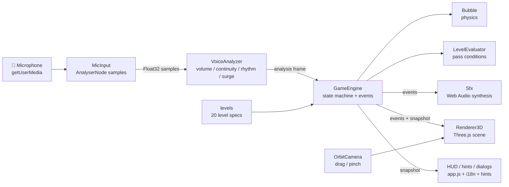
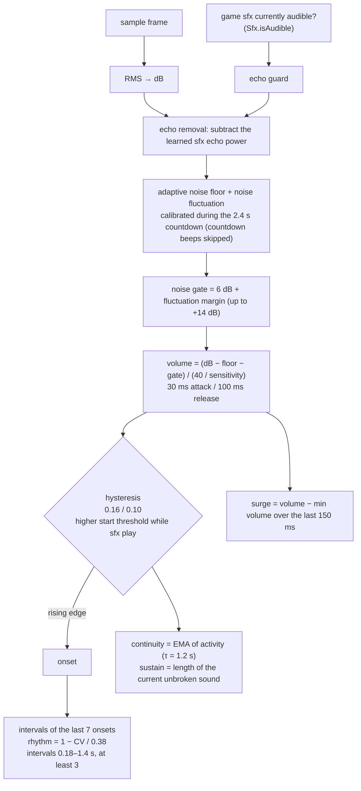
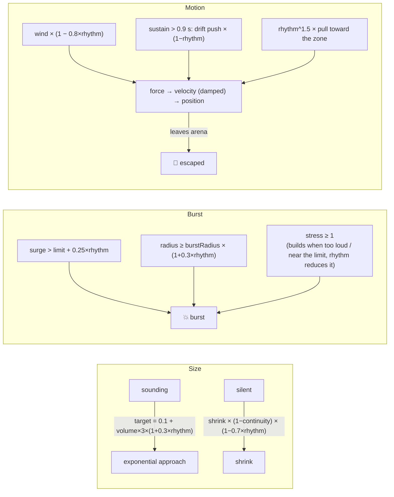
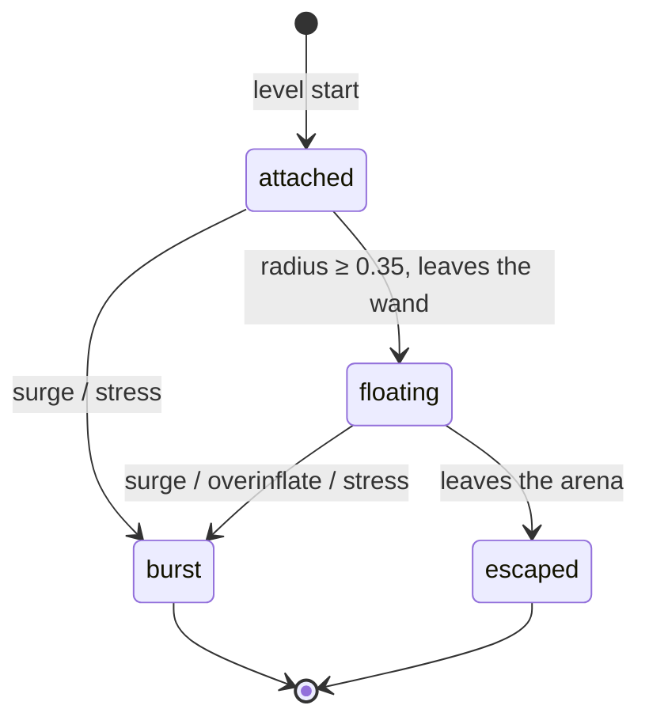
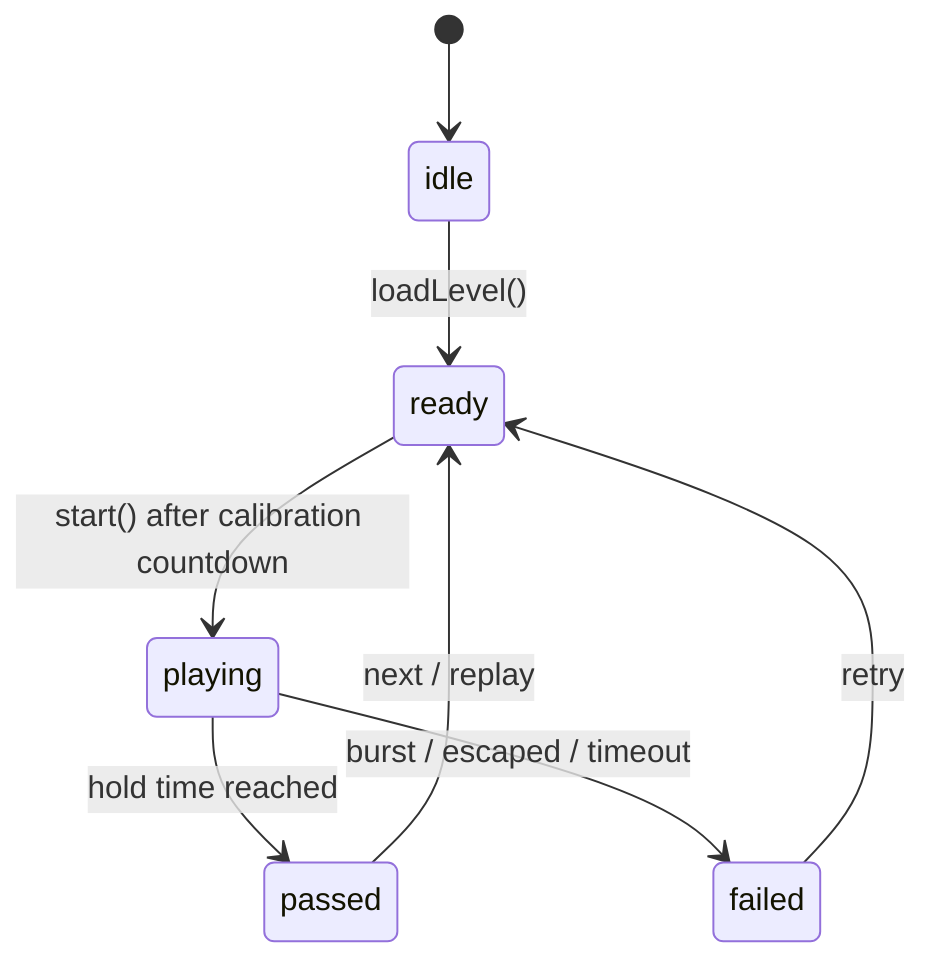
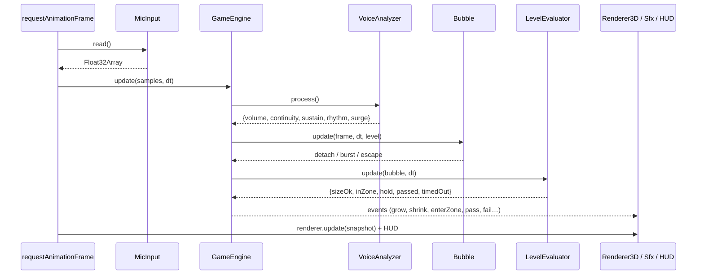
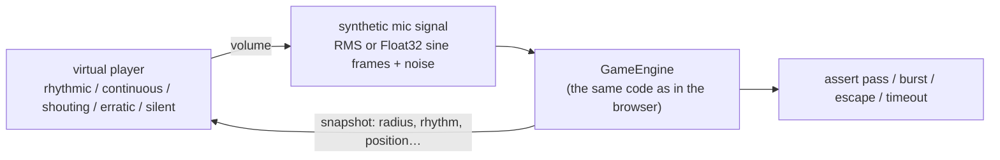

# 🫧 RoarBubbles

[中文](./README.md) | **English**

A 3D level-based web game where you **blow bubbles with your voice**. Blow or hum into the microphone: the **loudness**, **continuity** and **rhythm** of your sound decide how big the bubble gets, where it goes, and whether it survives. The final output is **one single-page HTML file** that runs in mainstream desktop and mobile browsers.

- 🎤 Input comes only from **audio input devices** such as a microphone. No files or other audio sources are accepted
- 🌍 3D scene (Three.js) that you can drag or pinch to view from any angle
- 🧩 20 levels across 5 terrains, from easy to hard
- 🔊 Procedurally synthesised sound effects (inflate, shrink, burst, fly away, level clear…) with an on/off toggle
- 🌐 Chinese / English UI
- ✅ 95 unit + closed-loop tests, plus an optional real-browser end-to-end closed-loop test

---

## Contents

- [Quick start](#quick-start)
- [How to play](#how-to-play)
- [Level design](#level-design)
- [How it works](#how-it-works)
- [Project layout](#project-layout)
- [Testing](#testing)
- [Extending](#extending)
- [Browser support](#browser-support)
- [License](#license)

## Quick start

Requires Node.js ≥ 22 for building, testing and the local server. There are **no npm dependencies at all**.

```bash
npm run build      # produce the single file dist/index.html
npm start          # build and serve at http://localhost:5173/
npm run dev        # serve the multi-file src/ version (handy for debugging)
npm test           # unit + closed-loop tests
npm run test:e2e   # optional: headless Chrome/Edge end-to-end closed loop
```

> ⚠️ Browsers only allow microphone access in a **secure context** (`https://` or `http://localhost`).
> To deploy, put `dist/index.html` on any HTTPS static host (GitHub Pages, Netlify, Nginx…).
> three.js (r128) loads from the cdnjs CDN. All other code and styles are inlined into that one HTML file.

## How to play

| Sound property | Effect on the bubble |
| --- | --- |
| **Volume** | Louder = bigger bubble; when quiet it slowly shrinks |
| **Sudden loudness** | A volume surge above the level's limit **pops it instantly** |
| **Loud for long / blown to the limit** | “Stress” builds up and the bubble bursts when it's full; growing past the burst radius also pops it |
| **Continuity** | Continuous sound keeps the bubble from **shrinking** during short pauses, but never stopping **blows it out of the arena** along the drift direction (it flies away) |
| **Rhythm** | Steady “hoo – hoo – hoo” pulses let the bubble **grow bigger without bursting** (higher burst radius and surge limit), reduce the wind, and **guide it to the target zone** so it doesn't drift off |

**To clear a level**, keep the bubble radius within the target range **and** keep the bubble inside the glowing target zone until the hold time adds up. Progress decays at a per-level rate while you are outside the target. Bursting, flying away or running out of time fails the level.

**HUD**

- Left: live Volume / Flow / Rhythm / Stress meters (BPM next to Rhythm)
- Right: bubble size (green band = target range, red line = burst point), zone status, hold progress, time left
- Yellow and pink rings inside the zone show the minimum and maximum target size
- Top bar: 📖 guide · 🗺️ levels · ⚙️ settings (mic sensitivity, sound volume, reset progress) · 🔊 sound toggle · ⟲ reset view
- The **中文 / EN** language switch in the top-right corner sits on the outermost layer, so it works even while the guide, level brief or any other dialog is open; the choice is saved locally
- Camera: drag to orbit and wheel to zoom with a mouse; one finger to orbit and pinch to zoom on touch screens; double-click resets the view

## Level design

20 levels, 4 per terrain: 🌼 meadow → 💧 lake → 🏜️ desert → ❄️ snow → 🌋 volcano.

| Aspect | Level 1 | Level 20 |
| --- | --- | --- |
| Target radius | 0.50 – 1.40 (wide) | 1.65 – 1.95 (narrow) |
| Zone radius | 2.40 | 0.99 |
| Zone distance from the wand | very close | far (high, off to the side) |
| Hold time | 3 s | 12 s |
| Wind / gusts | none | strong + gusty |
| Surge tolerance | 0.90 | 0.68 |
| Hold progress decay outside the target | 0.4 s/s | 3 s/s |
| Burst margin (burst radius − max target) | 0.90 | 0.38 |

The briefing before each level lists the size range, the target zone, the hold time and the time limit, plus a ★ difficulty rating. Clearing a level earns 1–3 stars depending on how fast you were. Progress is saved locally.

## How it works

### Architecture



Apart from the browser-facing files (`app.js`, `renderer3d.js` and similar), all core logic is **plain JavaScript** with no DOM or Web Audio dependency, so it can be tested directly in Node. Every module uses the same tiny UMD wrapper: in the browser it registers itself on `window.RB`, and in Node it exports through `module.exports`.

### Voice analysis (VoiceAnalyzer)



**No more "it played the level by itself"**: the speakers' sound effects reach the microphone. Treated as the player's voice, they form a feedback loop: an inflate bloop makes the bubble grow, which triggers another bloop. The bloops are evenly timed, so they also read as rhythm, which steers the bubble into the zone and can clear the level with nobody making a sound. The analyser has three safeguards:

1. **Noise gate that adapts to the room**: fluctuating noise (fans, keyboards) automatically raises the gate.
2. **Echo guard**: while a game sound plays (plus a ~0.12 s reverb tail), starting a new sound needs a clearly louder input.
3. **Echo power removal**: the echo level is learned on frames where the player is quiet and a sound effect is playing, and subtracted from the microphone signal.

The closed-loop `silent room` tests simulate a quiet room with fluctuating noise, keyboard clicks and speaker echo, and check that every level ends in a timeout, never a clear. They also check that a normal rhythmic player still clears every level with the echo present.

### Bubble physics



### Bubble and game states





### Per-frame data flow



### Rendering

- The bubble uses a custom `ShaderMaterial`: Fresnel rim, view-dependent **thin-film iridescence** and two specular highlights. Its vertices wobble with volume and stress, and it turns redder as stress rises
- Terrain is height-coloured and rolls into hills outside the arena. Each terrain has its own props (flowers, trees, lily pads, cacti, pines, ice, a volcano, lava pools, snow and ember particles)
- Burst: droplet particles + shockwave. Fly-away: the bubble accelerates upward and fades. Level clear: golden glow + confetti
- The target zone changes colour with its state: cyan (outside) → yellow (inside but wrong size) → pulsing green (conditions met, hold time counting)
- A ground shadow and a height line make the bubble's 3D position easy to read

### Sound effects

All sounds are synthesised live with Web Audio; there are no audio files: inflate “bloops” (lower pitch for bigger bubbles), a falling shrink tone, leaving the wand, the burst (filtered noise + low thump + droplets), a rising fly-away whistle, zone enter/leave chimes, a level-clear arpeggio, a failure motif and the countdown. 🔊 toggles sound and the settings panel sets the volume; both choices are saved locally. The browser's echo cancellation is enabled on the microphone, and the analyser adds its own echo guard for the game's sound effects (see above); headphones are still recommended.

## Project layout

```
RoarBubbles/
├── src/
│   ├── index.html            # page skeleton (multi-file for development)
│   ├── css/style.css         # responsive styles (desktop / mobile, dark mode)
│   └── js/
│       ├── config.js         # every tunable number
│       ├── utils.js          # math, vectors, events, safe storage
│       ├── i18n.js           # zh / en strings (including the guide)
│       ├── audioAnalyzer.js  # voice analysis
│       ├── bubblePhysics.js  # bubble physics
│       ├── levels.js         # 20 levels + build / validate / register
│       ├── levelEvaluator.js # pass conditions, stars
│       ├── gameEngine.js     # headless engine (state machine + events)
│       ├── hints.js          # live tip selection
│       ├── sfx.js            # procedural sound effects
│       ├── micInput.js       # microphone capture
│       ├── orbitCamera.js    # camera controls
│       ├── renderer3d.js     # Three.js renderer
│       └── app.js            # browser entry point that wires the modules together
├── scripts/
│   ├── build.js              # inline bundler → dist/index.html
│   └── serve.js              # zero-dependency static server
├── test/
│   ├── helpers/sim.js        # virtual players & microphone signal simulation
│   ├── helpers/echoSim.js    # silent room: noise + clicks + sfx echo
│   ├── unit/                 # unit tests
│   ├── closed-loop/          # closed-loop tests
│   └── e2e/                  # browser end-to-end closed loop (optional)
├── dist/index.html           # ✅ deliverable: single-page HTML
├── README.md / README.en.md
├── LICENSE
└── .gitignore
```

## Testing

Tests use Node's built-in `node:test`; nothing needs to be installed.

| Command | What it runs |
| --- | --- |
| `npm test` | unit + closed-loop tests (95) |
| `npm run test:unit` | unit tests only |
| `npm run test:loop` | closed-loop tests only |
| `npm run test:coverage` | coverage report (logic modules at ~90–98% line coverage) |
| `npm run test:e2e` | real page in headless Chrome/Edge (skipped automatically if no browser is found) |

**Unit tests** cover: utilities; voice analysis (volume monotonicity, hysteresis, onsets, rhythm/BPM, continuity, surge, noise floor calibration); bubble physics (each rule on its own); level data (validity, monotonic difficulty, reachable volume); the evaluator; the engine state machine, events and progress persistence; sound effects (fake AudioContext); the microphone (fake getUserMedia, including a check that only an audio input is requested); camera controls; hints; i18n key parity; and the build output (single file, boots in a browser-like global).

**Closed-loop tests**: on every tick a *virtual player* reads the game snapshot and adapts its loudness (feedback). The resulting microphone signal goes into the real engine:



What the closed-loop tests prove:

- A steady rhythmic player clears all 20 levels, also with ±20% human timing jitter (several seeds) and at tempos from 70 to 150 BPM
- Never stopping → the bubble flies away; shouting → it bursts; erratic noise → fail; silence → timeout
- A quiet room (fluctuating noise, clicks, speaker echo) never blows a bubble by itself, let alone clears a level; with the echo guard turned off, the old self-clearing bug comes back
- Difficulty curve: a sloppy rhythm clears the easy levels but fails the hard ones
- One engine plays all 20 levels in order, unlocking each next level and persisting progress
- Event order: grow → detach → enterZone → sizeOk → pass

**End-to-end test**: Chrome's built-in fake microphone device is the input. It drives the real page through WebGL rendering → countdown calibration → play → result dialog, and checks that no runtime errors occur.

## Extending

- **Add a level**: append an entry to `LEVEL_SPECS` in `src/js/levels.js` (name, terrain, zone, size, hold, time, wind, drift). Everything else is derived from `difficulty`, and you can override `zoneRadius`, `holdDecay` or `surgeLimit` explicitly. At runtime, call `RB.levels.registerLevel(spec)`, which validates the level. `levels.test.js` and the closed-loop tests check that new levels are valid and winnable.
- **Add a terrain**: `Renderer3D.registerTheme('name', {...})`, and add the name to `levels.THEMES`.
- **Add a sound**: `sfx.register('name', (ctx, out, params) => {...})`, then hook it to an engine event in `app.js`.
- **Add a language**: add a dictionary to `DICT` in `i18n.js` (a test checks its keys match the Chinese one).
- **Tune the feel**: every number lives in `src/js/config.js`. After changing one, run `npm test`; the closed-loop tests will tell you whether all 20 levels are still winnable.

## Browser support

Recent Chrome / Edge / Firefox / Safari, including iOS Safari and Android Chrome. The game needs WebGL, Web Audio and `getUserMedia`, and the page must be served over HTTPS or localhost. On iOS, audio is enabled by the tap on “Start blowing”, which is part of the normal flow.

## License

[MIT](./LICENSE)
