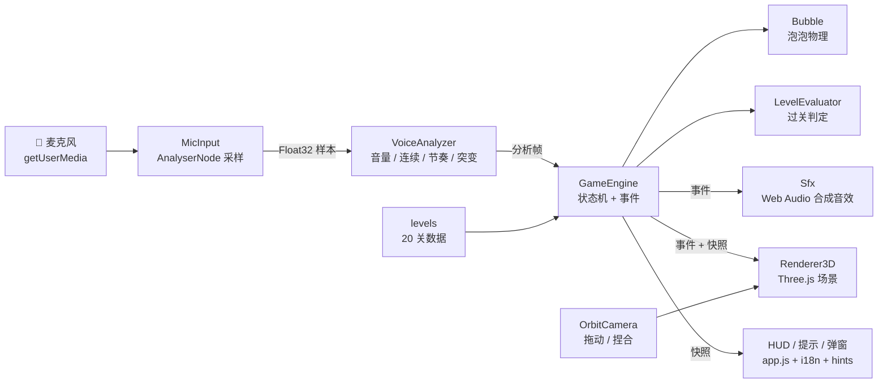
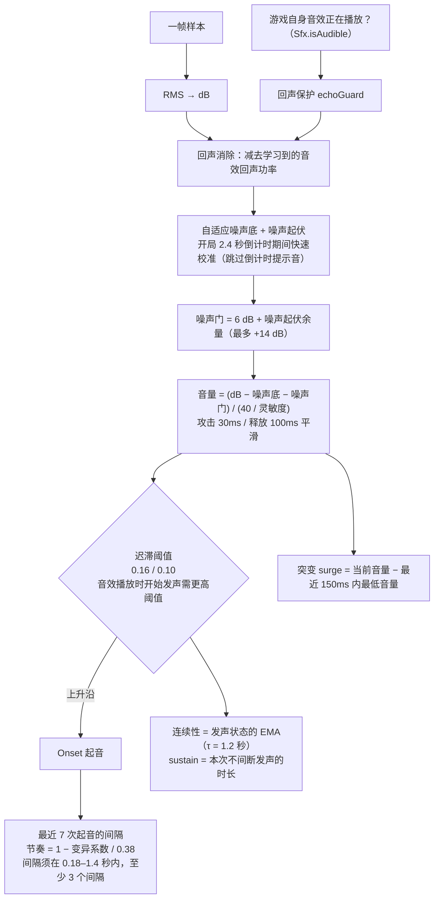
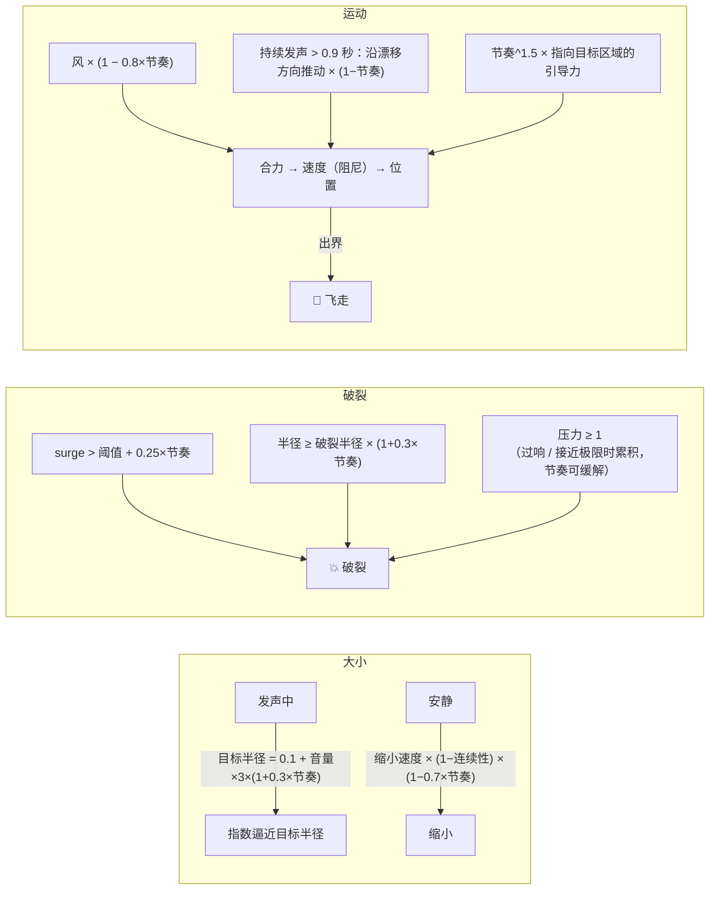
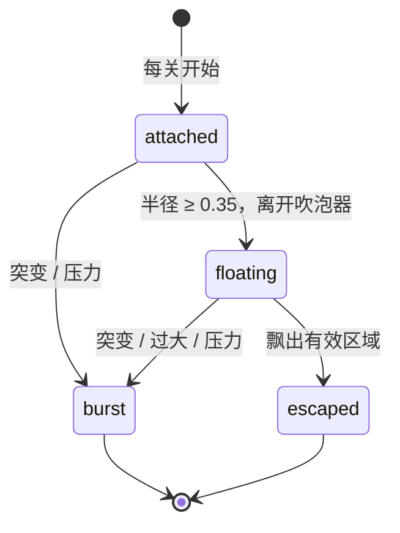
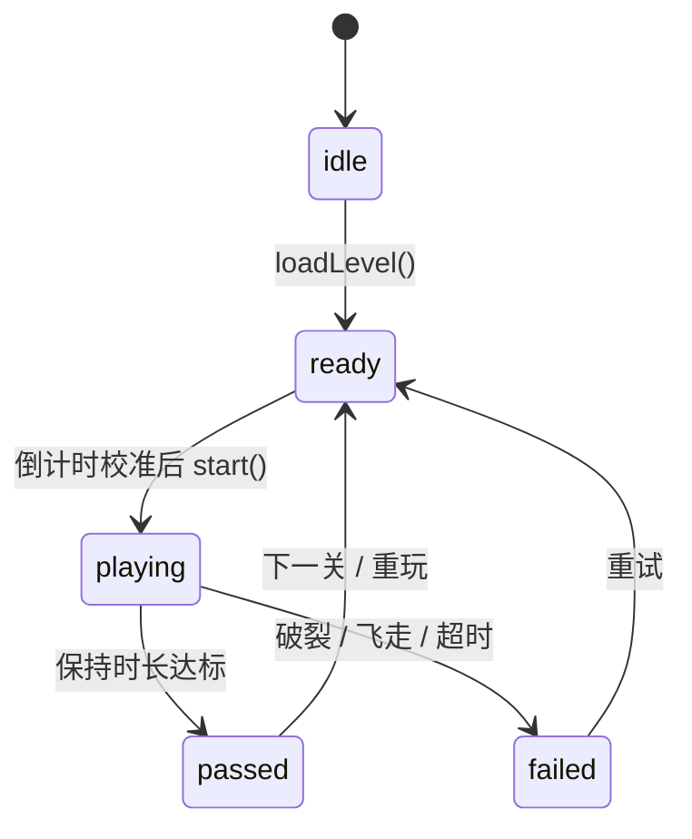
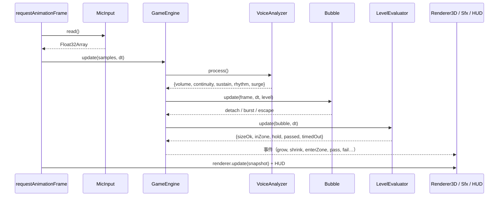
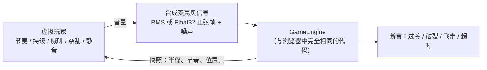

# 🫧 吼吼泡泡 RoarBubbles

**中文** | [English](./README.en.md)

一款**用声音吹泡泡**的 3D 闯关网页游戏。对着麦克风吹气或发声，声音的**大小**、**连续性**和**节奏**决定泡泡的大小、去向和生死。整个游戏最终输出为**一个单页 HTML 文件**，电脑和手机的主流浏览器都能运行。

- 🎤 唯一的输入是麦克风等**音频输入设备**，不接受文件或其它音源
- 🌍 3D 场景（Three.js），可拖动/捏合查看不同视角
- 🧩 20 个关卡，5 种地形，难度逐级递增
- 🔊 程序化合成音效（膨胀、缩小、破裂、飞走、过关…），可一键开关
- 🌐 中文 / English 界面切换
- ✅ 95 个单元测试和闭环测试，外加可选的真实浏览器端到端闭环测试

---

## 目录

- [快速开始](#快速开始)
- [玩法](#玩法)
- [关卡设计](#关卡设计)
- [实现原理](#实现原理)
- [项目结构](#项目结构)
- [测试](#测试)
- [扩展指南](#扩展指南)
- [浏览器兼容性](#浏览器兼容性)
- [许可证](#许可证)

## 快速开始

需要 Node.js ≥ 22（只用于构建、测试和本地服务，**没有任何第三方 npm 依赖**）。

```bash
npm run build      # 生成单文件 dist/index.html
npm start          # 构建并在 http://localhost:5173/ 提供服务
npm run dev        # 直接以 src/ 多文件形式运行（便于调试）
npm test           # 单元测试 + 闭环测试
npm run test:e2e   # 可选：无头 Chrome/Edge 端到端闭环测试
```

> ⚠️ 浏览器只允许在**安全上下文**（`https://` 或 `http://localhost`）中使用麦克风。
> 部署时把 `dist/index.html` 放到任意 HTTPS 静态服务器（GitHub Pages、Netlify、Nginx…）即可。
> 3D 引擎 three.js（r128）通过 cdnjs CDN 加载，其余代码和样式全部内联在这一个 HTML 中。

## 玩法

| 声音特征 | 对泡泡的影响 |
| --- | --- |
| **音量** | 声音越大，泡泡越大；安静时泡泡会慢慢变小 |
| **突然变大** | 音量骤增（surge）超过关卡阈值时，泡泡**立刻破裂** |
| **持续很大声 / 吹到极限** | “压力”逐渐累积，满了就破；超过破裂半径也会破 |
| **连续性** | 连续发声时，泡泡在短暂停顿中**不会变小**；但一直不停地吹会把泡泡沿风向**吹出有效区域**（飞走） |
| **节奏** | 稳定地“呼—呼—呼—”：泡泡**能变得更大且更不容易破**（破裂半径、突变阈值都会提高），风的影响变小，并被**引导到目标区域**、不会飘走 |

**过关条件**：泡泡半径在目标范围内，**并且**位于发光的目标区域中，累计达到保持时长（离开后进度会按关卡设定衰减）。超出时间限制、泡泡破裂或飞走都算失败。

**界面**

- 左侧面板：音量 / 连续 / 节奏 / 压力四个实时指标（节奏旁显示 BPM）
- 右侧面板：泡泡大小（绿色区间是目标范围，红线是破裂点）、目标区域状态、保持进度、剩余时间
- 目标区域里的黄色圆环、粉色圆环分别表示最小、最大目标尺寸
- 顶栏：📖 操作指引 · 🗺️ 关卡 · ⚙️ 设置（麦克风灵敏度、音效音量、重置进度） · 🔊 音效开关 · ⟲ 重置视角
- 右上角的 **中文 / EN** 语言切换始终位于最外层，打开操作指引、关卡简报等弹窗时也可以直接切换，选择会保存在本地
- 视角：鼠标拖动旋转、滚轮缩放；触屏单指旋转、双指捏合缩放；双击恢复默认视角

## 关卡设计

20 个关卡，每 4 关一种地形：🌼 草地 → 💧 湖泊 → 🏜️ 沙漠 → ❄️ 雪原 → 🌋 火山。

| 维度 | 第 1 关 | 第 20 关 |
| --- | --- | --- |
| 目标半径 | 0.50 – 1.40（宽） | 1.65 – 1.95（窄） |
| 目标区域半径 | 2.40 | 0.99 |
| 目标区域离吹泡器的距离 | 很近 | 远（高处、偏侧） |
| 保持时长 | 3 秒 | 12 秒 |
| 风力 / 阵风 | 无 | 强 + 阵风 |
| 突变容忍度 | 0.90 | 0.68 |
| 离开区域时的进度衰减 | 0.4 秒/秒 | 3 秒/秒 |
| 破裂余量（破裂半径 − 最大目标） | 0.90 | 0.38 |

每关开始前的简报会明确列出：大小范围、目标区域、保持时长和时间限制，并以 ★ 显示难度。通关后按用时获得 1–3 星，进度保存在本地。

## 实现原理

### 整体架构



除了 `app.js`、`renderer3d.js` 这类与浏览器相关的文件，所有核心逻辑都是**纯 JavaScript**：不依赖 DOM 和 Web Audio，所以能在 Node 中直接测试。每个模块都用同一个小型 UMD 包装：在浏览器里注册到 `window.RB`，在 Node 里通过 `module.exports` 导出。

### 声音分析（VoiceAnalyzer）



**防止“没出声也能自动过关”**：扬声器播放的音效会被麦克风收到。如果把它们当成玩家的声音，会形成“膨胀音 → 泡泡变大 → 又一声膨胀音”的反馈循环；而且音效节拍很规律，还会被识别成节奏，把泡泡引向目标区域，最终自己过关。分析器为此有三层保护：

1. **噪声门随环境起伏自适应**：风扇、键盘等起伏较大的环境噪声会自动抬高门限。
2. **回声保护**：游戏音效播放期间（以及之后约 0.12 秒的混响尾音），要开始一次新的发声需要更高的音量。
3. **回声功率扣除**：在玩家安静、而音效正在播放的帧里学习回声的大小，之后从麦克风信号中扣除。

闭环测试 `silent room` 模拟了“环境噪声 + 键盘点击 + 音效回声”的安静房间，验证 20 关都只会超时、不会过关；同时验证正常节奏的玩家在有回声的情况下仍能通关。

### 泡泡物理（Bubble）



### 泡泡与游戏状态





### 每帧数据流



### 渲染

- 泡泡使用自定义 `ShaderMaterial`：菲涅尔边缘 + 随视角变化的**薄膜干涉彩虹色** + 双高光；顶点按音量和压力抖动，压力越大越偏红
- 地形按高度着色，arena 外逐渐起伏成丘陵；每种地形有专属道具（花、树、睡莲、仙人掌、松树、冰面、火山、熔岩、雪花和余烬粒子）
- 破裂：粒子飞溅 + 冲击波；飞走：泡泡加速上升并淡出；过关：泡泡发金光 + 彩纸粒子
- 目标区域按状态变色：青色（未进入）→ 黄色（进入但尺寸不对）→ 绿色闪烁（满足条件，正在累积）
- 地面圆影和高度线帮助判断泡泡的 3D 位置

### 音效

全部由 Web Audio 实时合成，没有音频文件：膨胀的“啵”声（泡泡越大音调越低）、缩小的下滑音、脱离吹泡器、破裂（滤波噪声 + 低频冲击 + 水滴声）、飞走的上扬哨音、进入/离开区域的提示音、过关琶音、失败下行音、倒计时。🔊 按钮可开关音效，设置中可调音量，选择会保存在本地。麦克风开启了浏览器回声消除，分析器另有针对游戏自身音效的回声保护（见上文）；仍建议佩戴耳机。

## 项目结构

```
RoarBubbles/
├── src/
│   ├── index.html            # 页面骨架（开发时多文件）
│   ├── css/style.css         # 响应式样式（桌面 / 手机、深色模式）
│   └── js/
│       ├── config.js         # 所有可调参数
│       ├── utils.js          # 数学、向量、事件、安全存储
│       ├── i18n.js           # 中英文文案（含操作指引）
│       ├── audioAnalyzer.js  # 声音分析
│       ├── bubblePhysics.js  # 泡泡物理
│       ├── levels.js         # 20 关数据 + 生成/校验/注册
│       ├── levelEvaluator.js # 过关判定、星级
│       ├── gameEngine.js     # 无头游戏引擎（状态机 + 事件）
│       ├── hints.js          # 实时提示选择
│       ├── sfx.js            # 程序化音效
│       ├── micInput.js       # 麦克风采集
│       ├── orbitCamera.js    # 视角控制
│       ├── renderer3d.js     # Three.js 渲染
│       └── app.js            # 浏览器入口，负责把以上模块连起来
├── scripts/
│   ├── build.js              # 内联打包 → dist/index.html
│   └── serve.js              # 零依赖静态服务器
├── test/
│   ├── helpers/sim.js        # 虚拟玩家与麦克风信号模拟
│   ├── helpers/echoSim.js    # 安静房间：环境噪声 + 点击 + 音效回声
│   ├── unit/                 # 单元测试
│   ├── closed-loop/          # 闭环测试
│   └── e2e/                  # 浏览器端到端闭环测试（可选）
├── dist/index.html           # ✅ 最终产物：单页 HTML
├── README.md / README.en.md
├── LICENSE
└── .gitignore
```

## 测试

使用 Node 内置的 `node:test`，不需要安装任何依赖。

| 命令 | 内容 |
| --- | --- |
| `npm test` | 单元测试 + 闭环测试（95 个） |
| `npm run test:unit` | 仅单元测试 |
| `npm run test:loop` | 仅闭环测试 |
| `npm run test:coverage` | 覆盖率报告（逻辑模块的行覆盖率约 90–98%） |
| `npm run test:e2e` | 无头 Chrome/Edge 中的真实页面闭环（找不到浏览器时自动跳过） |

**单元测试**覆盖：工具函数、声音分析（音量单调性、迟滞、起音、节奏/BPM、连续性、突变、噪声底校准）、泡泡物理（每条规则单独验证）、关卡数据（合法性、难度单调递增、音量可达性）、过关判定、引擎状态机/事件/进度持久化、音效（伪造的 AudioContext）、麦克风（伪造的 getUserMedia，并校验只请求音频输入）、视角控制、提示、i18n 键一致性，以及构建产物（单文件、可在类浏览器环境中启动）。

**闭环测试**中，“虚拟玩家”每一帧读取游戏快照，据此调整发声音量（反馈），生成的麦克风信号再送入真实的引擎：



闭环测试验证的内容：

- 稳定节奏的玩家能通过全部 20 关；加入 ±20% 的人类节奏误差（多个随机种子）和 70–150 BPM 不同速度也都能通过
- 一直不停地吹 → 泡泡飞走；喊叫 → 破裂；杂乱无节奏 → 失败；静音 → 超时
- 安静房间（起伏噪声、点击声、扬声器回声）不会自己吹出泡泡、更不会过关；关闭回声保护时可以复现原来的“自动过关”问题
- 难度曲线：节奏很差的玩家能过简单关卡，但会在困难关卡失败
- 用同一个引擎按顺序通关 20 关，逐关解锁，进度被正确保存
- 事件顺序：grow → detach → enterZone → sizeOk → pass

**端到端测试**用 Chrome 自带的虚假麦克风设备作为输入，驱动真实页面走完 WebGL 渲染 → 倒计时校准 → 游戏 → 结果弹窗的全过程，并检查没有任何运行时错误。

## 扩展指南

- **新增关卡**：在 `src/js/levels.js` 的 `LEVEL_SPECS` 中追加一条记录（名称、地形、目标区域、尺寸、保持时长、时间、风、漂移方向）。其余参数由 `difficulty` 自动推导，也可以显式覆盖 `zoneRadius`、`holdDecay`、`surgeLimit`。运行时可以调用 `RB.levels.registerLevel(spec)`，它会自动校验。`levels.test.js` 和闭环测试会检查新关卡是否合法、能否通关。
- **新增地形**：`Renderer3D.registerTheme('name', {...})`，并把名称加入 `levels.THEMES`。
- **新增音效**：`sfx.register('name', (ctx, out, params) => {...})`，然后在 `app.js` 中把它绑定到引擎事件上。
- **新增语言**：在 `i18n.js` 的 `DICT` 中加一份字典（测试会检查键是否与中文一致）。
- **调整手感**：所有数值都集中在 `src/js/config.js`。修改后运行 `npm test`，闭环测试会告诉你 20 关是否仍然都能通过。

## 浏览器兼容性

Chrome / Edge / Firefox / Safari（含 iOS Safari、Android Chrome）的近期版本均可运行。需要 WebGL、Web Audio 和 `getUserMedia`，页面须以 HTTPS 或 localhost 打开。在 iOS 上需要点一下“开始吹泡泡”按钮才能启用音频，这一步已包含在正常流程中。

## 许可证

[MIT](./LICENSE)
